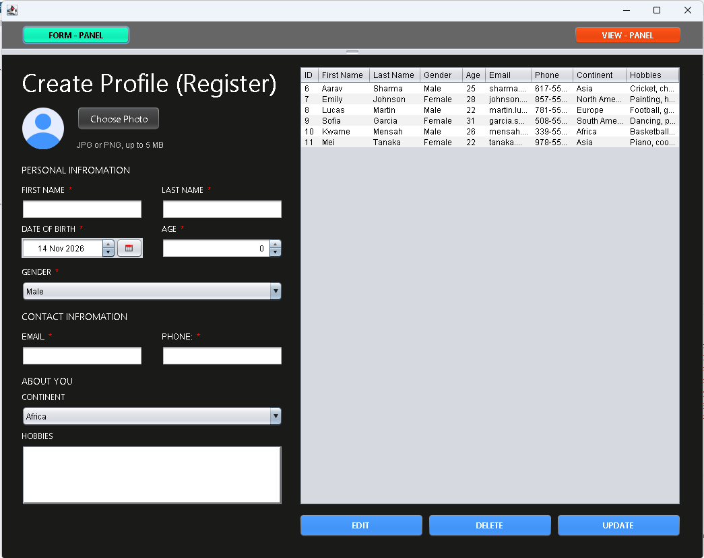
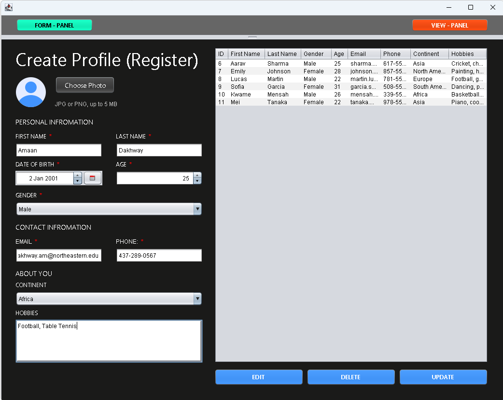
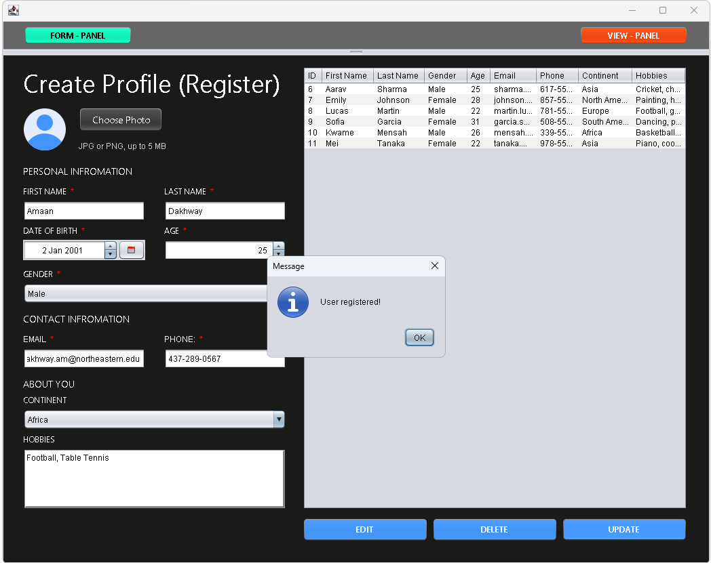
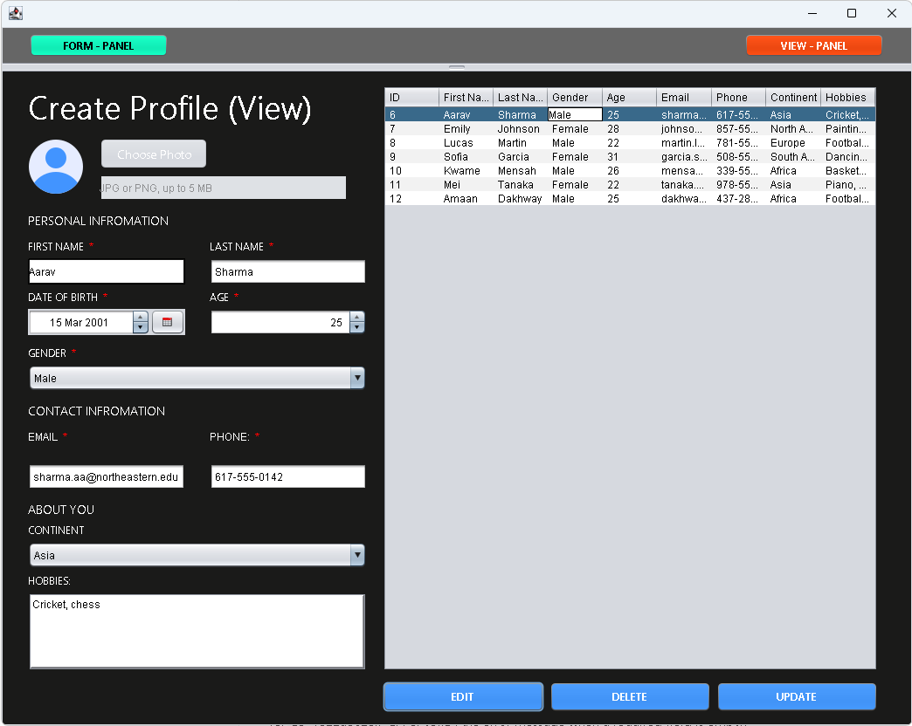
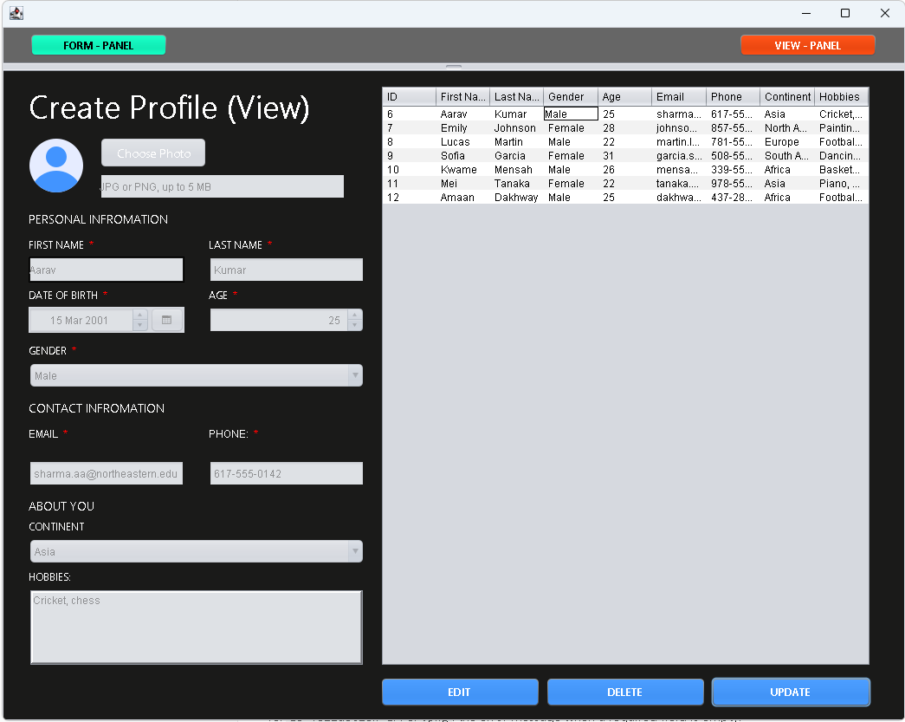
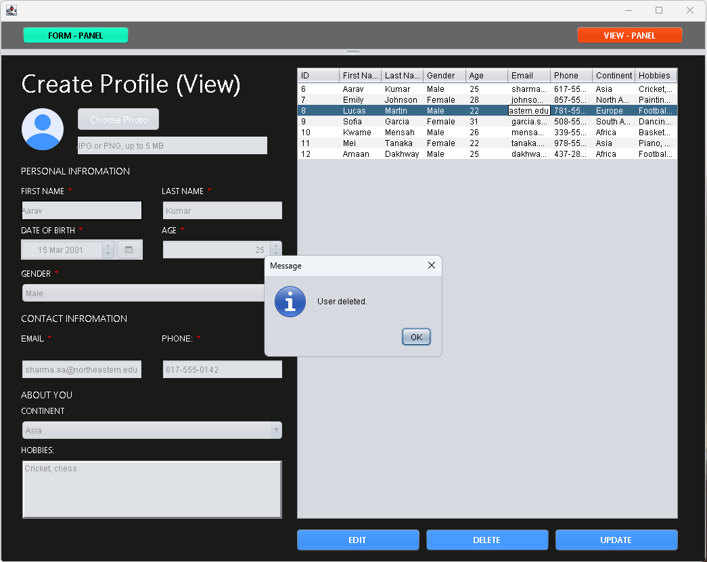
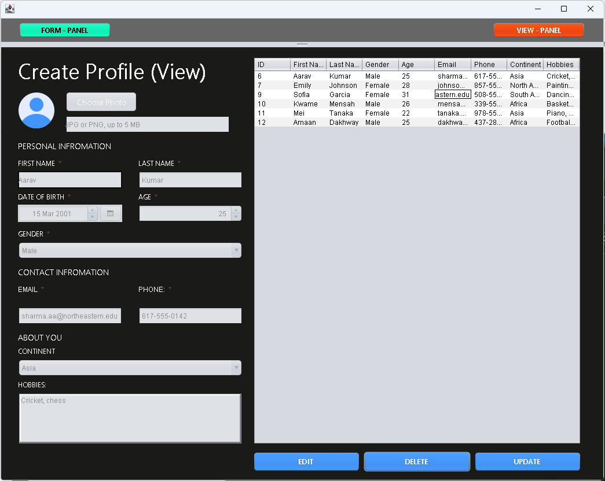
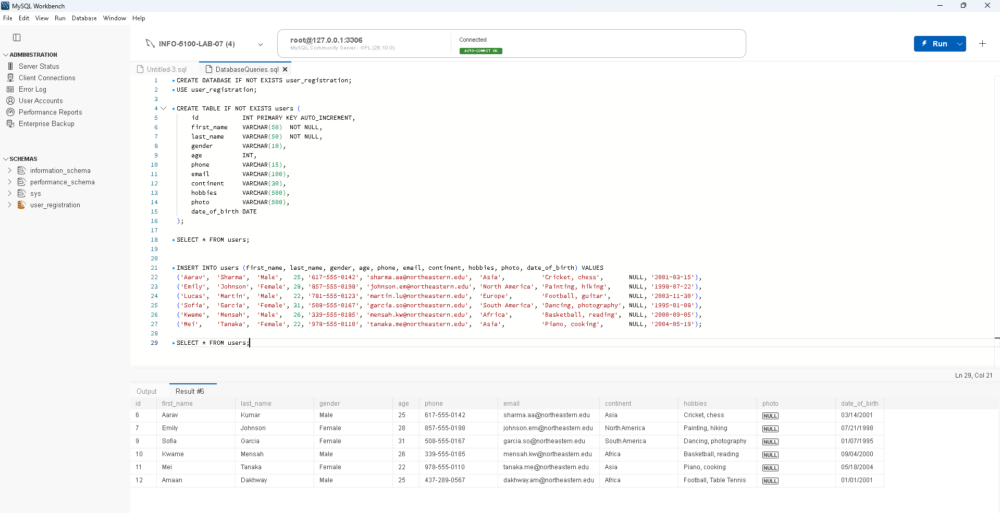

# Lab 7: JDBC User Registration (Java Swing + MySQL)

A Java Swing desktop application that connects to a MySQL database using JDBC and supports full **CRUD** (Create, Read, Update, Delete) operations on user records. The app has two views, a **Registration panel** and a **View panel**, and both show the data from the database in a **JTable**.

---

## Features

| Operation | Where | How |
|---|---|---|
| **Create** | Registration panel | Fill in the form and click **UPDATE** to insert a new user into the database |
| **Read** | Both panels | All users are loaded from MySQL into the JTable |
| **Update** | Both panels | Select a row, click **EDIT** to load it into the fields, change values, click **UPDATE** |
| **Delete** | Both panels | Select a row and click **DELETE** to remove it from the database |

- Navigation between panels using `CardLayout` (FORM PANEL / VIEW PANEL buttons)
- Tables refresh automatically after every change and when switching panels
- Date of birth picker automatically calculates the age
- Optional profile photo upload
- Input validation with error messages
- All SQL is kept in one class (`DatabaseConnector`) and uses `PreparedStatement` to prevent SQL injection

---

## Tech Stack

- **Java** (JDK 17+), **Java Swing** for the GUI
- **Apache NetBeans** (GUI Builder)
- **MySQL Server 8.x** and **MySQL Workbench**
- **JDBC** with **MySQL Connector/J**
- **JCalendar** for the date picker

---

## Project Structure

```
Lab7_JDBC/
├── src/
│   ├── db/
│   │   └── DatabaseConnector.java   # JDBC connection + all CRUD queries
│   ├── model/
│   │   └── User.java                # User model class
│   ├── ui/
│   │   ├── MainJFrame.java          # Main window with CardLayout navigation
│   │   ├── RegistrationJPanel.java  # Create form + JTable + Edit/Delete/Update
│   │   └── ViewJPanel.java          # View table + Edit/Delete/Update
│   └── icons/
│       └── user.png                 # Default profile picture
├── lib/                             # MySQL Connector/J and JCalendar JARs
├── INFO-5100-LAB-07-SCREENSHOTS/    # Screenshots of the running application
├── DatabaseQueries.sql              # Creates the database and table
└── README.md
```

---

## Database Schema

Database: `user_registration`  |  Table: `users`

| Column | Type | Notes |
|---|---|---|
| `id` | INT | Primary key, auto increment |
| `first_name` | VARCHAR(50) | Required |
| `last_name` | VARCHAR(50) | Required |
| `gender` | VARCHAR(10) | |
| `age` | INT | |
| `phone` | VARCHAR(15) | Format `123-456-7890` |
| `email` | VARCHAR(100) | |
| `continent` | VARCHAR(30) | |
| `hobbies` | VARCHAR(500) | |
| `photo` | VARCHAR(500) | File path, optional |
| `date_of_birth` | DATE | |

---

## Setup and Running

### 1. Install the requirements
- JDK 17 or newer
- Apache NetBeans
- MySQL Server and MySQL Workbench
- MySQL Connector/J (Platform Independent ZIP)

### 2. Create the database
Open MySQL Workbench and run `DatabaseQueries.sql`:

```sql
CREATE DATABASE IF NOT EXISTS user_registration;
USE user_registration;

CREATE TABLE IF NOT EXISTS users (
    id            INT PRIMARY KEY AUTO_INCREMENT,
    first_name    VARCHAR(50)  NOT NULL,
    last_name     VARCHAR(50)  NOT NULL,
    gender        VARCHAR(10),
    age           INT,
    phone         VARCHAR(15),
    email         VARCHAR(100),
    continent     VARCHAR(30),
    hobbies       VARCHAR(500),
    photo         VARCHAR(500),
    date_of_birth DATE
);
```

### 3. Add the libraries
In NetBeans, right-click **Libraries → Add JAR/Folder…** and add:
- `lib/mysql-connector-j-x.x.x.jar`
- the JCalendar JAR

### 4. Set your MySQL password
The app connects as `root` / `root` by default. If your password is different, go to **Project Properties → Run → VM Options** and add:

```
-Ddb.password=YOUR_PASSWORD
```

This keeps the password out of the source code and out of GitHub.

### 5. Run
Run `ui.MainJFrame`.

---

## Sample Data

```sql
INSERT INTO users (first_name, last_name, gender, age, phone, email, continent, hobbies, photo, date_of_birth) VALUES
('Aarav', 'Sharma',  'Male',   25, '617-555-0142', 'sharma.aa@northeastern.edu',  'Asia',          'Cricket, chess',       NULL, '2001-03-15'),
('Emily', 'Johnson', 'Female', 28, '857-555-0198', 'johnson.em@northeastern.edu', 'North America', 'Painting, hiking',     NULL, '1998-07-22'),
('Lucas', 'Martin',  'Male',   22, '781-555-0123', 'martin.lu@northeastern.edu',  'Europe',        'Football, guitar',     NULL, '2003-11-30');
```

---

## How It Works

1. **`DatabaseConnector`** opens a connection with `DriverManager.getConnection(...)` and provides `addUser`, `getAllUsers`, `editUser` and `deleteUser`. Each method uses a `PreparedStatement` inside try-with-resources, so connections are always closed.
2. **`populateTable()`** calls `getAllUsers()` and adds each user as a row in the JTable's `DefaultTableModel`.
3. **EDIT** reads the selected row index, finds that `User` in the list, and copies its values into the form fields.
4. **UPDATE** reads the fields into a `User` object and calls `addUser` (new user) or `editUser` (when editing).
5. **DELETE** calls `deleteUser(id)` for the selected row, then reloads the table.

---

## Screenshots

### Registration panel


### Adding a user



### Table populated from the database


### Editing a user



### Deleting a user



### Data in MySQL Workbench


---

## Author

**Amaan**, Northeastern University
